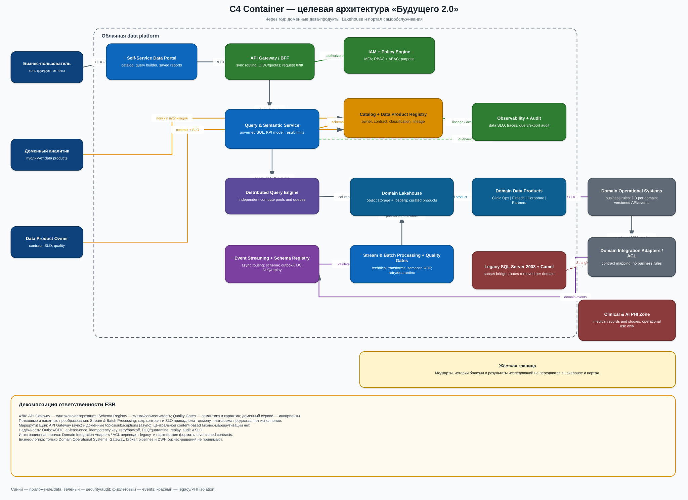

# Задание 1. Целевая архитектура и приоритизация проблем

## Целевая архитектура через год

Диаграмма показывает контейнеры, их ответственность и ключевые потоки. Логика портала не встраивается в общее DWH: Query Service строит запросы по семантическому слою, а данные публикуются доменами как версионируемые продукты.

### Поддержка бизнес-сценариев

| Сценарий | Как поддерживается |
|---|---|
| Отчёт за минуты, а не часы | Распределённый Query Engine читает оптимизированные Iceberg-таблицы; тяжёлые трансформации предвычисляются. |
| Самостоятельная сборка отчёта | Каталог показывает доступные дата-продукты, а семантический слой даёт единые метрики и термины. |
| Независимое развитие финтеха, клиник и ИИ | Доменные команды владеют своими API, событиями, хранилищами и SLA; домены не читают БД друг друга. |
| Подключение фармацевтики и медтеха | Новый домен публикует контракт в реестре, а типовой ingestion-конвейер записывает его продукт в Lakehouse. |
| Соблюдение финансовых и медицинских требований | Контуры изолированы; IAM и Policy Engine проверяют домен, роль, цель и атрибуты набора; выгрузки аудируются. |
| Масштабирование | Вычисления и хранилище масштабируются независимо; очереди и квоты не дают одному домену вытеснить остальные. |

### Куда переезжает логика Apache Camel ESB

ESB выводится не заменой на новый центральный «комбайн», а декомпозицией ответственности. Технические механизмы становятся платформенными сервисами, интеграционные преобразования переходят к доменным адаптерам, а бизнес-правила — к сервисам домена, который ими владеет.

| Ответственность в ESB | Целевой владелец и контейнер | Граница ответственности |
|---|---|---|
| Форматно-логический контроль (ФЛК) | `API Gateway / BFF` проверяет запрос, авторизацию и лимиты; `Schema Registry` — схему и совместимость событий; `Stream & Batch Processing + Quality Gates` — межполевые проверки, качество данных и карантин | Бизнес-инварианты, например допустимость кредита или медицинского назначения, проверяет только доменный сервис |
| Потоковые преобразования | Доменные jobs в `Stream & Batch Processing + Quality Gates`, читающие версионируемые topics | Нормализация, фильтрация, дедупликация и техническое обогащение; код, контракт и SLO принадлежат доменной команде |
| Пакетные преобразования | Доменные batch-pipelines в том же контейнере, запускаемые оркестратором | Построение `validated`/`curated` data products; ошибки уходят в карантин, повторный запуск идемпотентен |
| Маршрутизация | `API Gateway / BFF` для синхронных API; доменные topics и consumer subscriptions в `Event Streaming` для асинхронных потоков | В брокере нет центральной content-based бизнес-маршрутизации: получателя определяют контракт и подписка |
| Паттерны надёжности | `Outbox/CDC`, at-least-once delivery, idempotency key, retry с backoff, `DLQ`/quarantine, replay, аудит и SLO | Продюсер отвечает за атомарную публикацию, потребитель — за идемпотентность; платформа — за доставку и наблюдаемость |
| Интеграционная логика | `Domain Integration Adapters / ACL` преобразуют legacy- и партнёрские форматы в версионируемые API/события | Адаптеры не принимают бизнес-решения и не становятся новым ESB; каждый адаптер принадлежит домену |
| Бизнес-логика | `Domain Operational Systems` и их прикладные сервисы | Ни Gateway, ни broker, ни pipelines, ни DWH не содержат правил кредитования, лечения, расчёта тарифов или договорных условий |

Миграция выполняется маршрутом за маршрутом по паттерну Strangler Fig:

1. Все Camel routes инвентаризируются; для каждого фиксируются владелец, контракт, тип логики, SLO и сценарий отката. Неидентифицированная логика блокирует переключение.
2. Домен реализует версионируемый API/событие и свой ACL-адаптер. Новая ветка работает в shadow-режиме, а результаты, счётчики и контрольные суммы сверяются с ESB.
3. После прохождения quality, security, нагрузочного и DR-gates трафик переключается по одному потоку. Camel остаётся обратимым rollback-путём на период наблюдения, но новая логика в него больше не добавляется.
4. Route удаляется только после приёмки доменным владельцем и выполнения SLO; конфигурация и аудит архивируются. После миграции последнего потока отключаются Camel и legacy bridge.

## Проблемные места As-Is

Приоритет задан по MoSCoW. Внутри `Must` порядок определён матрицей «влияние на бизнес × срочность».

| ID | Проблема | Пострадавшие сценарии | Бизнес-риск | MoSCoW | Порядок |
|---|---|---|---|---|---:|
| P1 | SQL Server 2008 совмещает хранение, ETL и бизнес-логику; объём — сотни ТБ | все отчёты, новые продукты, финтех | EOL, простой, потеря выручки и невозможность расти | Must | 1 |
| P2 | Медицинские, финансовые, HR-данные и отчётность смешаны в одном DWH | банк, клиники, ИИ, аудит | неконтролируемый доступ, нарушение регуляторных границ | Must | 2 |
| P3 | Сложные отчёты строятся часами и конкурируют с ETL | управленческая и финансовая отчётность | поздние решения, плохой UX, рост time-to-market | Must | 3 |
| P4 | Любая новая логика финтеха и ИИ меняет центральное DWH | запуск финтех- и ИИ-функций, M&A | команды блокируют друг друга; изменение ломает отчёты | Must | 4 |
| P5 | Нет владельца, каталога, lineage, SLO и автоматических quality gates | самообслуживание, кросс-доменные отчёты | неверные метрики, дубли, низкое доверие к данным | Must | 5 |
| P6 | Apache Camel ESB — единый интеграционный центр с скрытыми трансформациями | подключение новых компаний | единая точка сбоя, дорогая интеграция | Should | 6 |
| P7 | PowerBuilder и сильно кастомизированный Power BI связаны со схемой DWH | операторы, аналитики | дефицит специалистов, дорогие релизы | Should | 7 |
| P8 | Инфраструктура не версионируется; нет целевых RPO/RTO и регулярных DR-тестов | все критичные сервисы | длительный простой, ручные ошибки, непредсказуемые затраты | Must | 8 |
| P9 | Нет единых контрактов и onboarding-шаблона для партнёров | фармацевтика, медтех | задержка M&A-синергии | Could | 9 |
| P10 | Командам не хватает облачных, Data Mesh и SRE-компетенций | миграция и эксплуатация | невыполнимый роадмап, зависимость от подрядчика | Should | 10 |

### Матрица «влияние × срочность»

- **Критично и срочно:** P1, P2, P3, P4 — блокируют целевую архитектуру и несут прямой операционный/регуляторный риск.
- **Критично, но планово:** P5, P8 — закладываются в landing zone и первый data-product-шаблон.
- **Важно и срочно:** P6, P7 — расцепляются при миграции первых двух доменов.
- **Важно и планово:** P9, P10 — решаются через платформенные шаблоны, учебные пилоты и pairing.

## Нефункциональные цели

- Отчёты по типовым витринам: p95 до 30 с; ad-hoc запросы: p95 до 5 мин.
- Свежесть: критичные финтех-наборы до 5 мин, остальные до 1 часа.
- Доступность портала и query-слоя: 99,9%; RPO ≤ 15 мин, RTO ≤ 2 ч.
- Новый дата-продукт из шаблона — не более 10 рабочих дней; подключение нового домена — до 6 недель.
- 100% наборов имеют owner, schema, classification, SLA и lineage; 100% выгрузок аудируются.
