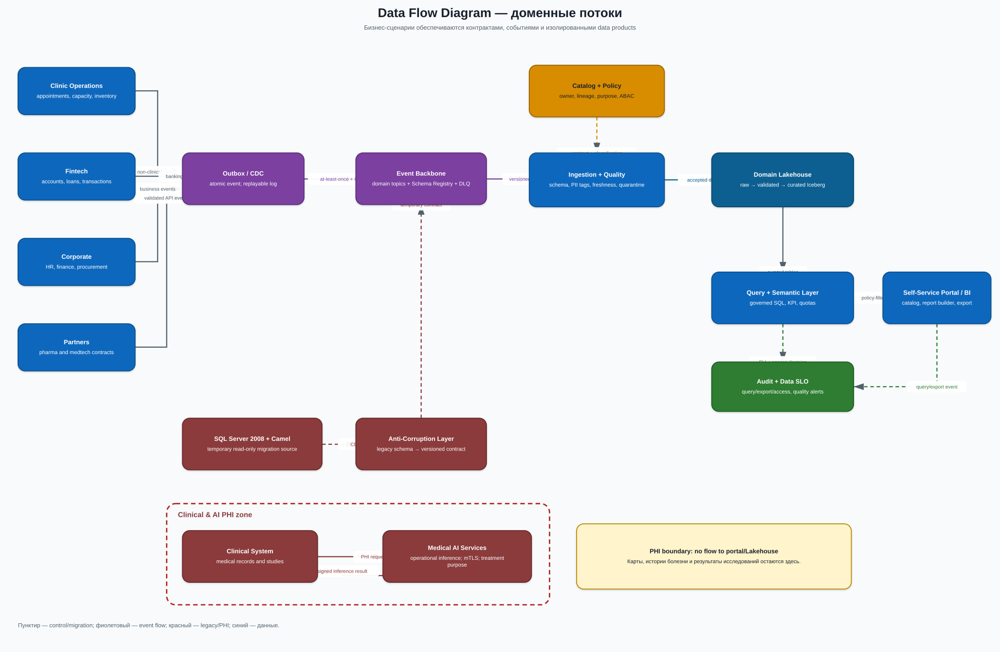

# Задание 2. Домены и потоки данных

## Границы доменов

Граница проводится по business capability и владению данными. У каждого домена есть команда, операционные сервисы, контракты и дата-продукты. Платформенная команда не переносит к себе бизнес-логику: она даёт self-service-шаблоны, каталог, IAM, наблюдаемость и quality gates.

| Домен | Ответственность | Ключевые дата-продукты | Ограничения |
|---|---|---|---|
| Customer & Identity | единый customer ID, контакты, согласия, golden record | `customer-360-safe`, `consent-status` | ПДн шифруются; атрибуты выдаются по purpose/ABAC |
| Clinic Operations | филиалы, запись, ресурсы, немедицинская часть услуг, инвентарь | `clinic-capacity`, `appointments-kpi`, `inventory-balance` | Нет диагнозов, карт, историй болезни и результатов исследований |
| Clinical & AI | медкарты, исследования, клинические AI-модели и результаты | не публикуется в аналитическую витрину | Отдельный PHI-контур; только операционные вызовы по purpose `treatment` |
| Fintech | счета, кредиты, транзакции, риск-модели, финансовая отчётность | `portfolio-daily`, `payments-aggregate`, `credit-risk-summary` | Банковский контур, маскирование и row-level policy; без PAN/секретов в Lakehouse |
| Corporate | HR, закупки, бюджет, общая финансовая отчётность | `headcount-summary`, `budget-fact`, `procurement-kpi` | Зарплата и персональные HR-поля доступны только HR/финансам |
| Partners | онбординг фармацевтики и медтеха, каталоги и поставки | `partner-catalog`, `supply-status`, `device-telemetry-safe` | Карантин входных данных, версионный contract, отдельная tenant/policy |
| Data Platform | ingestion, event backbone, Lakehouse, catalog, query/semantic layer, портал | не владеет бизнес-данными | Единые guardrails, квоты, encryption, lineage, audit |

## Data Flow Diagram

### Основные потоки

1. **Операционный поток.** Доменный сервис атомарно сохраняет изменение и outbox-событие. CDC публикует событие в доменный topic; потребители идемпотентны.
2. **Аналитический поток.** Ingestion-конвейер проверяет schema, класс чувствительности, freshness и качество; провальные пакеты идут в quarantine. Принятые данные записываются в доменные Iceberg-таблицы.
3. **Самообслуживание.** Портал читает каталог, отправляет логический запрос в Query Service, а тот применяет policy, транслирует запрос в distributed SQL и аудирует результат и выгрузку.
4. **Новый финтех-сервис.** Он работает внутри банковского контура, публикует доменные события и агрегированный data product. Ни один другой домен не читает его БД.
5. **ИИ в медицине.** Клиническая система передаёт данные AI-сервису внутри PHI-контура по mTLS и получает результат обратно. Этот поток не связан с аналитическим Lakehouse.
6. **Новый партнёр.** Партнёр проходит API-шлюз, contract/schema validation и quarantine. После приёмки его данные становятся продуктом домена Partners, а не новыми таблицами в DWH.
7. **Миграция legacy.** CDC-коннектор и anti-corruption layer публикуют версионированные контракты. Для каждого отчёта идёт параллельная сверка до переключения.

## Контракт дата-продукта

Каждый набор публикует:

- `owner`, `domain`, `description`, `business_terms`;
- версию schema и compatibility policy;
- классификацию полей и разрешённые purposes;
- SLO на freshness, completeness и availability;
- quality rules и допустимую долю отбраковки;
- retention, residency, lineage и условия удаления;
- idempotency key и semantics доставки для событий.

Breaking change создаёт новую major-версию; предыдущая живёт до миграции всех зарегистрированных потребителей.

## Почему такое разделение ускоряет бизнес

- Новая функция финтеха не требует релиза Clinic/AI и переделки общей схемы DWH.
- Изменение в медицинской системе не расширяет круг доступа к PHI и не ломает витрину.
- Партнёр подключается по шаблону, а не через разовую доработку ESB и DWH.
- Сбой одного ingestion-потока не останавливает остальные; квоты и separate compute pools локализуют нагрузку.
- Семантический слой сохраняет единое понимание KPI, хотя данными владеют разные домены.
