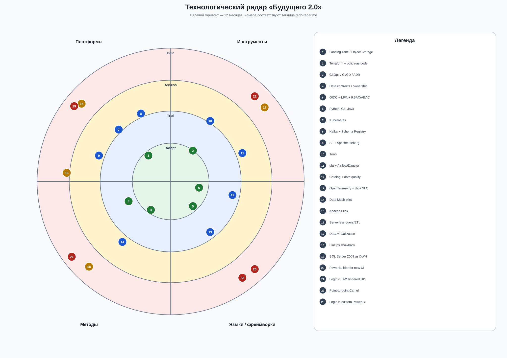
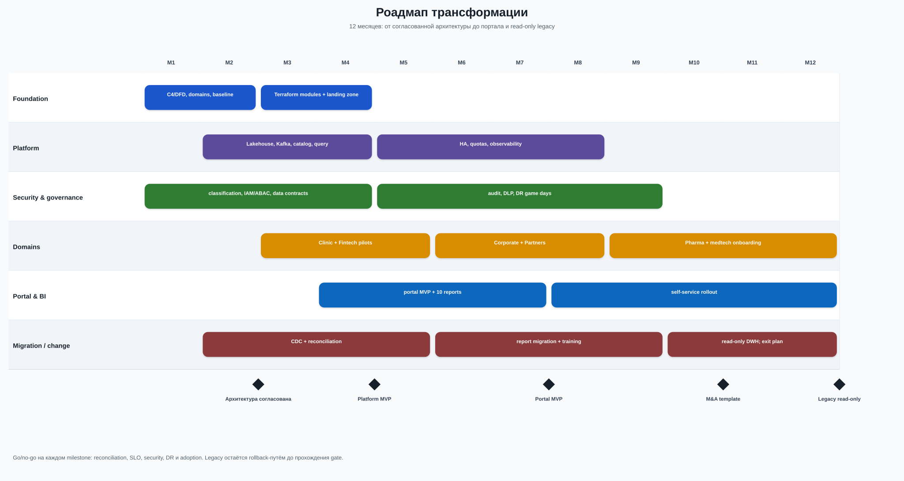

# Задание 3. Технологический радар и роадмап

## Технологический радар

Расшифровка каждого решения, его тренд и связь с бизнесом даны в [`tech-radar.md`](tech-radar.md).

## Дорожная карта

Подробные этапы, ответственные, ресурсы, критерии выхода и бизнес-обоснование даны в [`roadmap.md`](roadmap.md).

План строится по принципу strangler: новая платформа постепенно перехватывает отчёты и интеграции. SQL Server, PowerBuilder и Camel не выключаются до подтверждённой сверки, обучения пользователей и проверенного rollback.
