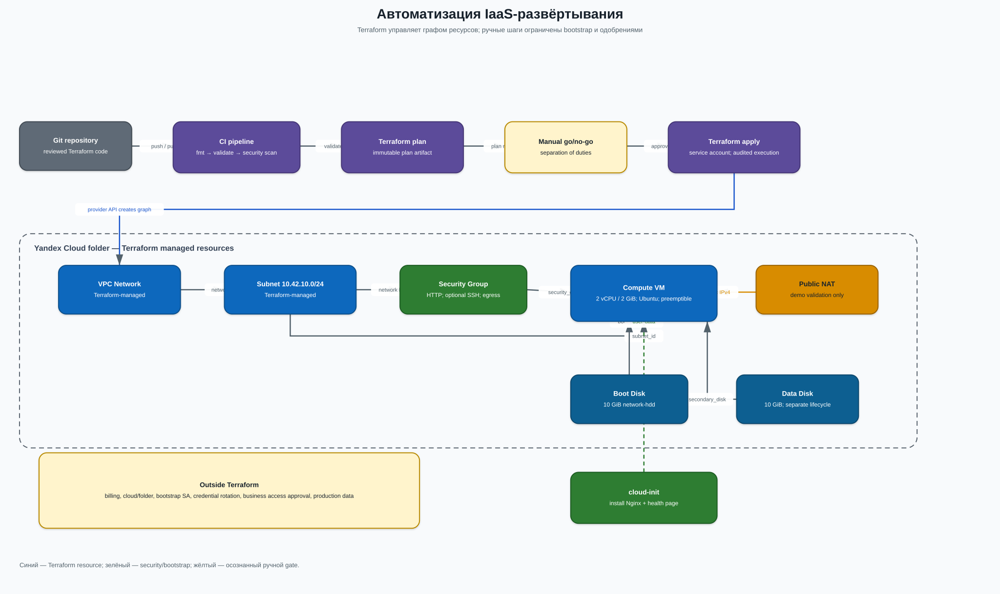

# Задание 4. IaaS и Terraform



## Что управляется Terraform

- VPC Network и Subnet;
- Security Group с HTTP, опциональным SSH и egress;
- отдельный диск данных;
- VM с boot disk, подключённым data disk и NAT;
- cloud-init, который ставит Nginx и публикует health page;
- labels, связи между ресурсами и outputs.

## Что остаётся вне Terraform

- создание организации, billing account, cloud/folder и первичного service account;
- хранение service-account key вне Git и его ротация;
- выдача бизнес-ролей и подтверждение доступа владельцами данных;
- загрузка production-данных и ключей в KMS/Secret Manager;
- ручное go/no-go-одобрение production apply для защиты separation of duties.

## Запуск

Секреты и account ID не коммитятся. Они передаются провайдеру через переменные окружения:

```bash
export YC_CLOUD_ID="..."
export YC_FOLDER_ID="..."
export YC_SERVICE_ACCOUNT_KEY_FILE="/secure/path/sa-key.json"

terraform init
terraform fmt -check
terraform validate
terraform plan -out=portal.tfplan
terraform apply portal.tfplan
```

Если Cloud Shell аутентифицирован, но не содержит активного профиля `yc`, идентификаторы можно передать явно, не сохраняя их в репозитории:

```bash
terraform plan \
  -var='cloud_id=...' \
  -var='folder_id=...' \
  -out=portal.tfplan
terraform apply portal.tfplan
```

Тестовая среда одноразовая. После фиксации результата она удаляется:

```bash
terraform destroy
```

## Доказательства

- [`evidence/terraform-apply.png`](evidence/terraform-apply.png) — скриншот успешного `terraform apply`.
- [`evidence/terraform-apply.txt`](evidence/terraform-apply.txt) — ключевые строки успешного прогона и smoke-теста без идентификаторов ресурсов.
- [`evidence/terraform-destroy.txt`](evidence/terraform-destroy.txt) — подтверждение удаления тестовых ресурсов и итоговой проверки, чтобы не оставлять расходы.

Подробное обоснование — в [`justification.md`](justification.md).
